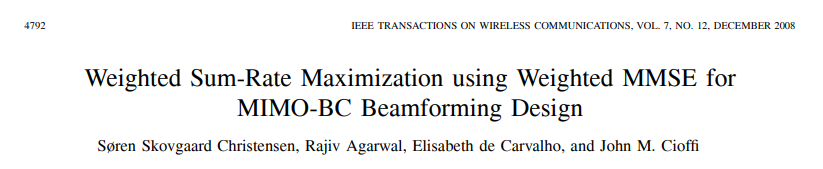
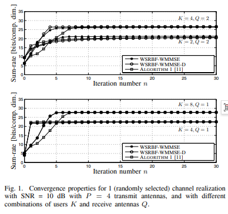
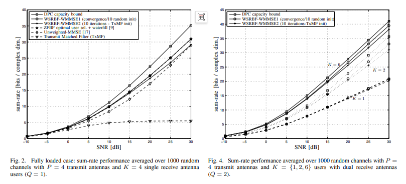
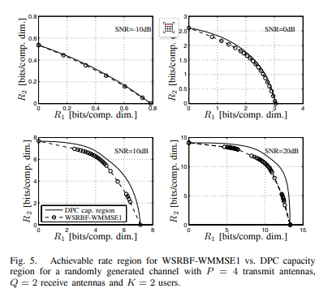

# Beamforming Breakthrough: Overcoming the Limitations of MIMO-BC Beamforming! A Low-Complexity Weighted Sum Rate Maximization Scheme Based on Weighted MMSE [with MATLAB Code]

Personal Blog: https://www.cnblogs.com/EWFrontier  
✿Breaking through the bottleneck of MIMO-BC beamforming! A low complexity weighted sum rate maximization scheme based on Weighted MMSE  
✿I. Title Based on Weighted MMSE for MIMO-BC Beamforming Design: Maximizing Weighted Sum Rate  
II. Abstract This paper studies the problem of designing linear transmit filter for maximizing weighted sum rate (WSR) in multi-input multi-output broadcast channel (MIMO-BC). The problem of finding optimal transmit filter is non-convex and difficult to solve by low complexity methods. Inspired by recent research results about mutual information and minimum mean square error (MMSE), this paper establishes the relationship between weighted sum rate and weighted minimum mean square error (WMMSE) under MIMO-BC scenario, and proposes two low complexity algorithms based on alternating optimization to find local optimal solution of weighted sum rate. Numerical results show that the proposed algorithm can achieve excellent sum rate performance with only a few iterations.  
III. Introduction Multi-input multi-output (MIMO) systems have great potential for achieving high throughput in wireless communication [1]. In cellular systems, base stations can easily deploy multiple antennas to enhance system capacity. When the transmitter obtains channel state information (CSI), the base station can transmit data to multiple users simultaneously, making the system throughput linearly increase with the number of transmit antennas, which can be achieved by either linear or nonlinear transmission techniques.
For multi-input multi-output broadcast channels (MIMO-BC), nonlinear techniques have been proven to outperform linear ones and achieve channel capacity, with the optimal strategy for downlink capacity being nonlinear dirty paper coding (DPC) [2]. However, the practicalized technology of DPC [3]-[5] is still in its initial development stage due to its high computational complexity, making it difficult to be deployed in practice. This makes linear downlink transmission techniques, also known as beamforming, attractive alternatives due to their simplicity [6]-[9]. The core of transmit beamforming design is to find a linear transmit filter that processes the data to be transmitted to different users before it is transmitted through the channel.
This paper focuses on the problem of maximizing weighted sum rate (WSR) under power constraint through transmit beamforming design, which has non-convexity and is challenging to solve. WSR can be used for prioritizing different users, thus having various practical application scenarios: for example, weights can be selected based on queue status to achieve maximum stability service [10]; or equal weights can be used to maximize the sum rate corresponding to best-effort service.
Recent research [11] has proposed an iterative algorithm based on the duality of mean square error (MSE) between uplink and downlink, starting from a given initial point, which can converge to a local optimal solution for WSR. Its core principle is to iteratively update the filter structure between the downlink system and the virtual uplink system, and solve geometric programming (GP) to optimize the allocation of transmit power. Another recent study [12] attempted to solve the WSR problem based on the idea in [8], but the algorithm was a four-step iterative process, where two steps required solving iterative properties of geometric programming (GP) and second-order cone programming (SOCP), resulting in higher complexity.
This paper employs different research approaches to solve the weighted sum rate maximization problem, proposing an iterative algorithm that ensures convergence to a local optimum solution. Drawing on recent research findings about the correlation between information theory quantities (mutual information) and MMSE in single-user MIMO channels [13]-[14], this paper establishes the correlation between weighted sum rate and weighted minimum mean square error (WMMSE) in the MIMO-BC scenario. By comparing the gradients of the weighted sum rate with the weighted MSE cost function, this paper reveals a straightforward relationship between the two problems' Karush-Kuhn-Tucker (KKT) conditions, essentially proving that the maximization of weighted sum rate can be transformed into solving the weighted MSE problem with optimized MSE weights.
Utilizing the established correlation, this paper proposes an iterative algorithm for weighted sum rate optimization in MIMO-BC. This algorithm alternately iterates through three steps: WMMSE transmit filter design, closed-form expression-based MMSE receive filter calculation, and weighted matrix update, all of which are solved using closed-form expressions, offering a complexity lower than existing multi-level iterative algorithms [11]-[12]. The paper introduces two algorithm versions: the first version calculates the weighted matrix based on the correlation between weighted sum rate and weighted MSE; the second version additionally constrains the weighted matrix to be diagonal, which allows each user to obtain decoupled data streams while achieving optimal weighted sum rate. Finally, this paper compares the convergence speed and sum rate performance of the proposed algorithm with other recent algorithms through numerical results.
IV. Methodology Introduction 1. Core Correlation Establishment The key breakthrough of this paper lies in establishing a deep correlation between weighted sum rate (WSR) and weighted minimum mean square error (WMMSE): by comparing the gradients of their cost functions, it is found that when the MSE weight satisfies (where represents the user rate weight and denotes the MMSE matrix), the KKT conditions of WSR and WMMSE can simultaneously be satisfied. This means that the maximization problem of WSR can be equivalently transformed into solving the weighted MSE problem with optimized weights, providing a theoretical foundation for low-complexity solution.
2. The iterative optimization framework proposed in this paper is based on the idea of iterative optimization, with the core being to iterate until convergence among three steps without the need for multi-level nested iterations, significantly reducing complexity:
•  
Step 1: Based on the previous round's emission filter, calculate the MMSE receiver filter using a closed expression;
•  
Step 2: Based on the current MMSE matrix, update the weight matrix according to the above weight formula;
•  
Step 3: Based on the current receiver filter and weight matrix, solve the WMMSE emission filter through a closed expression, and satisfy the emission power constraint with a gain factor.
3. Two versions of algorithms•  
Basic version (WSRBF-WMMSE): The weight matrix is freely updated based on the correlation between WSR and WMMSE, achieving local optimal WSR but the MMSE matrix may be non-diagonal, requiring joint decoding for multiple data streams;
•  
Low complexity version (WSRBF-WMMSE-D): The constrained weight matrix is diagonal, utilizing the property of unitary matrices to diagonalize, enabling the MMSE matrix to be transformed into a diagonal form, achieving user data stream decoupling without joint decoding, significantly reducing the complexity at the receiving end, while maintaining WSR performance close to the basic version.
5. Conclusion This paper focuses on the design problem of beamforming in MIMO-BC scenarios, focusing on maximizing the weighted sum rate as the objective. Influenced by research on mutual information and MMSE correlation, this paper establishes for the first time a simple correlation relationship between the weighted sum rate and weighted MMSE in MIMO-BC, providing a low-complexity solution path for the non-convex problem of maximizing WSR.
Based on this association, this paper proposes two iterative algorithms based on alternating optimization. The core process employs closed-form expressions for solution, avoiding the complex geometric planning or second-order cone programming solving steps in existing algorithms. Numerical results demonstrate that even with a simple emitter matched filter initialization, the proposed algorithms can achieve excellent sum rate performance with only a few iterations. They perform stably under different system configurations (full/overload, single/multiple receive antenna users), and can approximate the DPC capacity boundary. Additionally, the WSRBF-WMMSE-D version can reduce the decoding complexity at the receiver end.
★

## Images

<!-- PAYMENT_BLOCK -->

## Get this dataset

- Payment link (Stripe): [Buy now](https://buy.stripe.com/3cs8yP7sY87d0vu9AB)
- Payment QR code: 

<!-- /PAYMENT_BLOCK -->
